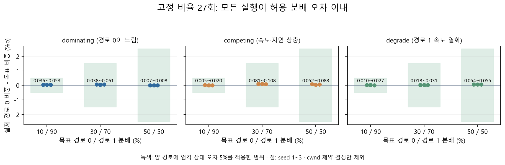
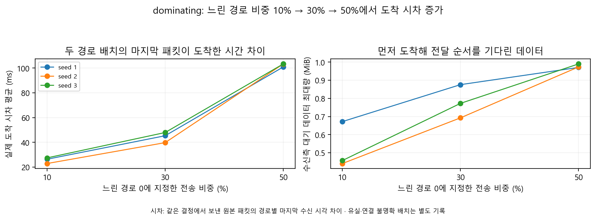

## 1. 3주차 작업 내용

### 1-1. 신규 스케줄러 연결·바이트 분배 변환 테스트 (기본 동작 유지·단위 검증 통과)

| 확인 항목 | 검증 내용 | 결과 |
|---|---|---|
| 스케줄러 ID 7 연결 | 명령 인자 → 속성 → 선택 분기 → MinRTT-multi 호출 | 기본 9회가 공식 기준값과 일치 |
| 분배 변환 `BytesToRatio` | 경로별 바이트 요청을 순차 잔량 기준 비율로 변환 | 실제 버퍼 분할 30/70·10/90·50/50 확인 |
| 경계값·관찰 정확성 | 빈 버퍼·MSS(패킷 단위) 미만·초과 요청·중복·순서 밖 FIN | 단위 검증 4개 모두 통과 |

- **구현 범위**
  - 실행 옵션
    - `SchedulerType=7` 연결, 이후 알고리즘에 사용할 `NewKappa`·`NewBeta`·`NewSmax` 인자와 설정 로그 추가
  - **결과**
    - **ID 7의 기본 동작은 MinRTT-multi와 동일. 고정 비율은 별도 옵션으로 실행**

### 1-2. 기존 스케줄러·옵션형 계측 비교 테스트 (공식 기준값과 모두 일치)

| 테스트 | 측정 범위 | 결과 |
|---|---|---|
| 기존 스케줄러 보존 | ID 0~6·3시나리오·seed 1, ID 6의 추가 seed 2~3 | 27/27회 공식 기준값과 일치 |
| ID 7 초기 동작 | 계측 비활성·활성 각각 3시나리오·seed 1~3 | 각각 9/9회 ID 6 기준값과 일치 |
| 계측 활성화 전후 송수신 이벤트 | 기본 3시나리오, 고정 비율 3개, 열화·회복 구간 | 7쌍·14회 실행, 이벤트 714,792행 일치 |

- **수행 조건**
  - 유지 설정
    - 목표 5,242,880B, OLIA 혼잡 제어, 설정 손실률 0, 완료 후 대기 250ms, 제한 시뮬레이션 시각 60초
  - 비교 기준
    - 2주차 공식 동결 데이터에서 같은 시나리오·스케줄러·seed의 수신량·전송 시간 대조
  - **결과**
    - **기준 대조 45/45건 일치. 관찰 옵션을 껐을 때와 켰을 때 송수신·손실·상태 이벤트 동일**

### 1-3. 고정 비율 송신 테스트 (27/27회 분배 오차 범위 충족)

| 시나리오 | 목표 경로 0/1 비중 | 실제 경로 0 비중 | 최소 포함 바이트 비중(반올림) | 분배 통과 | 완료·전체 수신 |
|---|---|---|---|---|---|
| dominating | 10/90% | 10.036~10.053% | 약 97.2% | 3/3 | 3/3 |
| dominating | 30/70% | 30.038~30.061% | 약 88.3% | 3/3 | 3/3 |
| dominating | 50/50% | 50.007~50.008% | 약 81.3% | 3/3 | 3/3 |
| competing | 10/90% | 10.005~10.020% | 약 91.8% | 3/3 | 3/3 |
| competing | 30/70% | 30.081~30.108% | 약 80.8% | 3/3 | 3/3 |
| competing | 50/50% | 50.052~50.083% | 약 90.9% | 3/3 | 3/3 |
| degrade | 10/90% | 10.010~10.027% | 약 97.2% | 3/3 | 3/3 |
| degrade | 30/70% | 30.018~30.031% | 약 85.0% | 3/3 | 3/3 |
| degrade | 50/50% | 50.054~50.055% | 약 36.2% | 3/3 | 3/3 |

- **실제 분배 확인**
  - 방법
    - `week3_validate.py`와 고정 비율 ID 7로 3시나리오 × 3비율 × seed 1~3 = 27회 실행
    - cwnd(수신 확인 없이 보낼 수 있는 양) 부족 결정만 제외하고, 나머지 송신 결정의 실제 STREAM 프레임 바이트를 경로별 합산
  - **결과**
    - **양 경로 상대 오차 최대 0.526%로 허용 5% 이내. 27/27회 목표 데이터 전체 수신**
    - **제외 후 최소 포함 비중 약 36.2%. 열화·50/50에서는 창 축소 구간이 많아 포함 비중 감소**

### 1-4. 도착 시차·수신 대기량 기록 테스트 (느린 경로 비중에 따른 변화 확인)

- **두 경로 도착 시간 차이 확인**
  - 측정 대상
    - `dominating`의 느린 경로 0: 5~5.5Mbps·50~55ms, 빠른 경로 1: 10~11Mbps·10~11ms
    - 같은 결정에서 보낸 패킷을 송신·수신 기록으로 연결해 경로별 마지막 패킷 수신 시각 대조
  - **결과**
    - **느린 경로 비중 10% → 30% → 50%에서 평균 시차 25.59ms → 44.37ms → 102.53ms. 같은 seed 3개에서도 증가**
    - **고정 비율의 실제 도착 시차 배치 7,878개 기록. 원본 패킷 미수신 배치 384개·송신 연결 불명확 배치 33개 별도 보존**
- **옵션형 계측**
  - 기록 내용
    - 결정 시각·분배 비율·전송 한도·RTT(왕복 시간)·미확인 송신량·버퍼 잔량
    - 도착 예상·실제 시차·누적 시차, 수신측 순서 대기량·대기 시간, 경로별 송신·재전송·누적 사용량
  - **결과**
    - **수신 프레임 260,050행이 재정렬 관찰 기록과 일치. 계측은 기본 비활성, 실행별 CSV 3종 분리**

## 2. 문제 상황 - 고정 비율 진단에서 전송 창 부족 구간 처리

- **고정 배치 송신 (지정한 경로별 분배량을 함께 보낼 수 있을 때 송신)**
  - 최초 문제 상황
    - ACK(수신 확인)마다 경로별 여유만큼 보내면 대부분이 전송 한도 제약 구간. 최초 27회 중 25회 분배 오차 초과
  - 수정
    - 고정 비율 옵션에서만 경로별 바이트를 미리 확정하고 양 경로의 여유 확보 후 송신
    - 초기 전송 한도가 목표 배치보다 작을 때는 부분 송신으로 전송 창 확대
  - **결과**
    - **3개 고정 비율·3시나리오·seed 1~3 모두 분배 기준 충족**
- **창 축소 시 부분 송신 허용 (막힌 경로가 정상 경로까지 멈추는 현상 방지)**
  - 최초 문제 상황
    - 대기 방식 적용 후 `degrade`·50/50의 3회 미완료. 한 경로의 전송 창이 줄어 기존 미확인 데이터가 한도를 초과
  - 수정
    - 미확인 송신량이 줄어든 전송 창보다 클 때는 정상 경로의 제한된 부분 송신 허용
  - **결과**
    - **해당 3회 모두 완료·전체 수신. 최종 기본 검증 72/72회와 계측 대조 14/14회 완료·전체 수신**
    - **기존 ID 0~6·공통 QUIC 재전송 로직·2주차 동결 데이터 유지**

## 3. 게이트 3 검증 결과

- **게이트 3 (고정 비율대로 송신하고 두 경로의 도착 시차를 확인)**
  - 분배 기준
    - cwnd 제약 구간 제외 후 30/70·10/90·50/50의 양 경로 상대 오차 5% 이내
  - 확인 자료
    - 실제 송신·결정 로그·도착 시차·수신 대기량 CSV와 단위 검증 기록 보존
  - **결과**
    - **분배·로그·도착 시차 항목 충족. 단계별 독립 검토와 원시 데이터 재계산 일치**

## 4. 다음 작업

- **4주차 계획 (확장 시나리오와 재현·인계 자료 준비)**
  - 테스트 대상
    - 경로 열화·긴 전송·4경로 동작 한계와 반복 실행 안정성
  - 산출물
    - 재현 패키지·3~4쪽 중간 보고서

## 5. 참고 자료

- **3주차 구현 브랜치**
  - https://github.com/JS-KETI/MPQUIC_Scheduler_Lab/tree/lab/week3-scheduler-20261012

- 작업 브랜치 `lab/week3-scheduler-20261012`의 코드·측정 데이터·보고 자료

- **최종 72회 실행의 완료·수신량·전송 시간**
  - https://github.com/JS-KETI/MPQUIC_Scheduler_Lab/blob/lab/week3-scheduler-20261012/artifacts/week3-2026-10-12/run-03/results.csv
- **고정 비율 27회 실제 분배·완료·도착 시차·수신 대기량**
  - https://github.com/JS-KETI/MPQUIC_Scheduler_Lab/blob/lab/week3-scheduler-20261012/artifacts/week3-2026-10-12/run-03/analysis/fixed_ratio_summary.csv
- **도착 시차의 배치별 원시 연결·누적값**
  - https://github.com/JS-KETI/MPQUIC_Scheduler_Lab/blob/lab/week3-scheduler-20261012/artifacts/week3-2026-10-12/run-03/analysis/decision_metrics.csv
- **계측 활성화 전후 송수신 이벤트 대조**
  - https://github.com/JS-KETI/MPQUIC_Scheduler_Lab/blob/lab/week3-scheduler-20261012/artifacts/week3-2026-10-12/run-03/trace-equivalence/summary.csv
- **계측 로그의 항목·단위·계산 방법**
  - https://github.com/JS-KETI/MPQUIC_Scheduler_Lab/blob/lab/week3-scheduler-20261012/reports/week3/records/%EA%B3%84%EC%B8%A1%20%EB%A1%9C%EA%B7%B8%20%ED%98%95%EC%8B%9D.md
- **조건별 실행 명령·미통과 시도·수정 검증 기록**
  - https://github.com/JS-KETI/MPQUIC_Scheduler_Lab/blob/lab/week3-scheduler-20261012/reports/week3/records/3%EC%A3%BC%EC%B0%A8%20%EC%83%81%EC%84%B8%20%EC%8B%A4%ED%97%98%20%EA%B8%B0%EB%A1%9D.md
