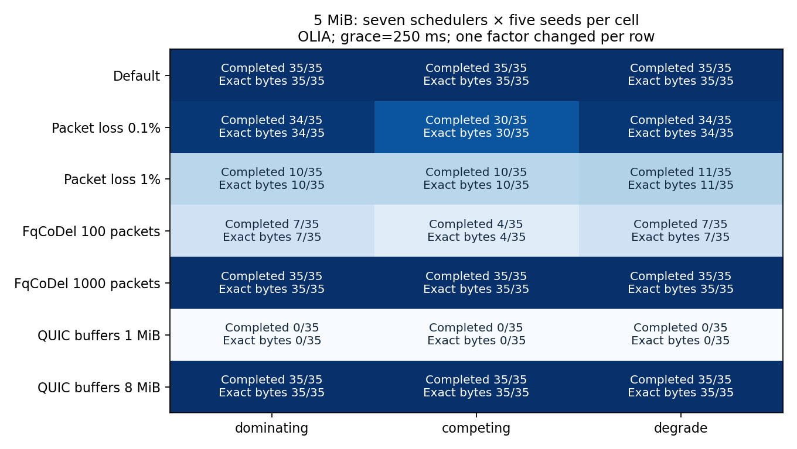
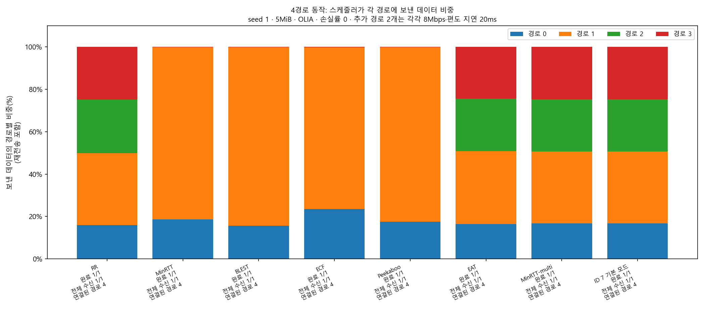
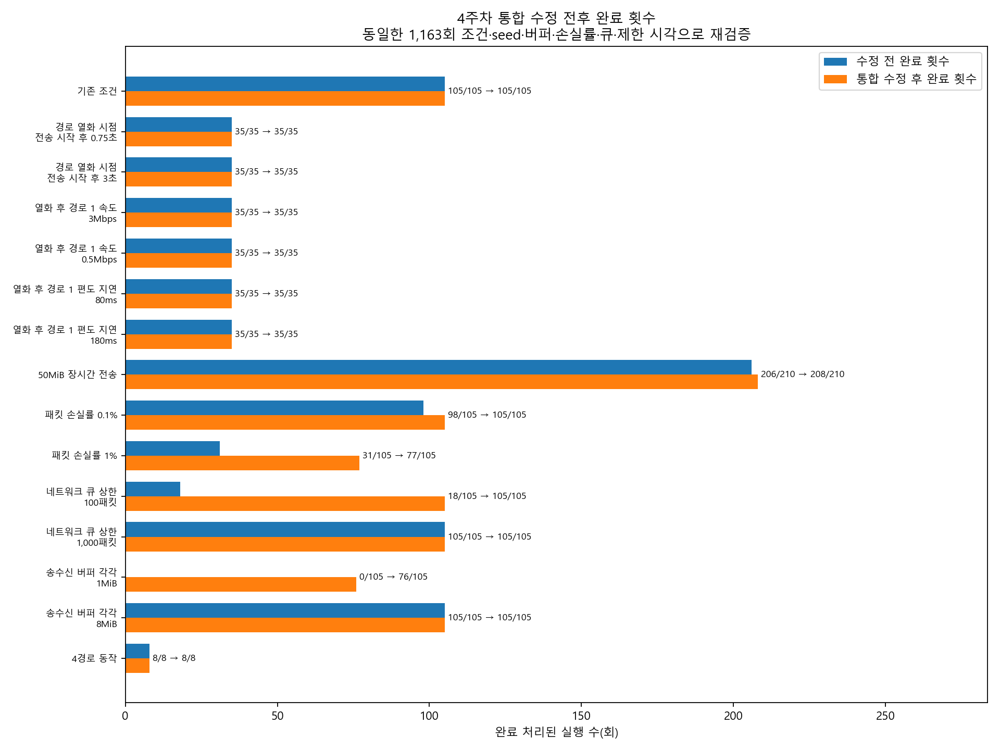
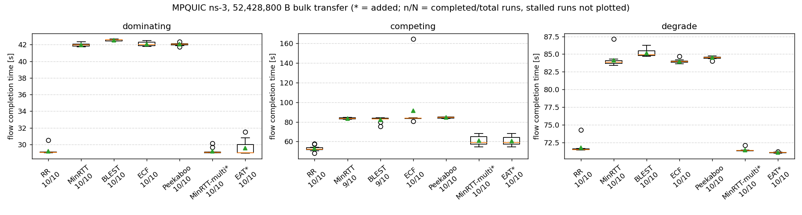

## 1. 4주차 작업 내용

- **작업 목적**
  - 경로 성능 저하·긴 전송·손실률·큐·버퍼 변화에서 기존 스케줄러의 성능과 한계 확인
  - 5주차 자동 경로 분배 알고리즘을 비교할 측정값과 재현 환경 준비

**스케줄러 이름과 동작 방식**

스케줄러는 데이터를 어느 경로로 보낼지 정하는 방식. RTT는 데이터를 보내고 수신 확인이 돌아오기까지의 왕복 시간.

| 이름 | 이 실험 코드의 경로 선택 방식 |
|---|---|
| RR | 활성 경로를 차례로 하나씩 선택 |
| MinRTT | 두 경로 중 RTT가 짧은 경로 우선, 전송 여유가 없으면 다른 경로 선택 |
| BLEST | RTT가 짧은 경로가 막히면, 다른 경로로 보낼지 기다릴지 판단 |
| ECF | 남은 데이터량·전송 여유·RTT로 완료 시간을 추정해 경로 선택 |
| Peekaboo | RTT가 짧은 경로 우선, 막히면 경로 상태와 이전 전송 결과로 선택 |
| MinRTT-multi | 전송 여유가 있는 모든 경로를 한 번에 사용 |
| EAT | 예상 도착이 빠른 경로 우선, 완료에 도움이 되는 다른 경로도 사용 |
| ID 7 기본 모드 | 신규 알고리즘용 확장 번호. 이번 테스트에서는 MinRTT-multi와 동일 |

- **측정값 읽는 법**
  - 완료·전체 수신
    - 완료는 목표량보다 3,000B 적게 받아도 충족하는 코드 기준. 전체 수신은 목표 바이트를 모두 받은 실행
  - 전송 시간·시나리오
    - 전송 완료 시간은 전송 시작부터 완료 처리까지의 시간. 평균·분포는 완료 실행만 집계
    - dominating은 한 경로가 속도·지연 모두 유리, competing은 빠른 경로의 지연이 더 큼, degrade는 전송 중 경로 1 성능 저하

1절은 수정 전 측정, 2절은 문제와 수정, 3절은 같은 조건의 수정 후 결과.

### 1-1. 기존 조건·경로 열화 테스트 (315/315회 완료·전체 수신)

| 테스트 | 변경한 설정 | 완료·전체 수신 횟수 |
|---|---|---:|
| 기존 조건 재현 | 3개 시나리오 × 7개 스케줄러 × seed 1~5 | 105/105 |
| 성능 저하 시점 | 전송 시작 후 1.5초 → 0.75초·3초 | 70/70 |
| 성능 저하 후 경로 1 속도 | 1Mbps → 0.5Mbps·3Mbps | 70/70 |
| 성능 저하 후 경로 1 지연 | 120ms → 80ms·180ms | 70/70 |

- **수행 방법·기준 대조**
  - 조건
    - `week4_run.py`로 한 설정씩 변경. 5MiB(5,242,880B)·OLIA 혼잡 제어·손실률 0·종료 대기 250ms·제한 시각 60초 유지
    - seed는 난수 조건을 재현하는 번호. 같은 시나리오·seed끼리 스케줄러 비교
  - **결과**
    - **기존 105회는 공식 2주차 기준값과 일치. 확장 실험에는 사전 제공 기준값이 없어 추가 측정값으로 보존**

### 1-2. 50MiB 장시간 전송 테스트 (206/210회 완료·전체 수신)

| 시나리오 | 완료·전체 수신 횟수 | 미완료 스케줄러 |
|---|---:|---|
| dominating | 70/70 | 없음 |
| competing | 66/70 | BLEST 3회·ECF 1회 |
| degrade | 70/70 | 없음 |

- **장시간 비교 데이터 구축**
  - 조건
    - 50MiB(52,428,800B), 3개 시나리오 × 7개 스케줄러 × seed 1~10. 버퍼 4종 각각 80,000,000B, 제한 시각 180초
  - **결과**
    - **전체 210회를 별도 장시간 기준 데이터로 동결. 수정 후 전송 시간 분포는 3절에 표시**

### 1-3. 손실률·큐·버퍼 변화 테스트 (357/630회 완료·전체 수신)

- **설정 변화에 따른 완료율·성능 순위 확인**
  - 조건
    - 손실률 0 → 0.1%·1%, 큐(전송 대기 공간) 상한 10,240 → 100·1,000패킷
    - 송수신 버퍼 4종 각각 40,000,000B → 1MiB·8MiB. 설정별 3개 시나리오 × 7개 스케줄러 × seed 1~5
  - **결과**
    - **작은 큐·버퍼와 높은 손실률에서 미완료 집중. 그림의 각 칸은 35회 기준**
    - **설정 변경 전후 평균 전송 시간의 우열 변화 12개 관찰. 두 스케줄러가 모두 완료한 공통 seed가 1~5개로 적어 탐색 결과로 기록**

### 1-4. 4경로 동작 테스트 (8/8회 완료·전체 수신)

- **경로 수 확장 확인**
  - 조건
    - 기존 두 경로에 8Mbps·20ms 경로 두 개 추가. ID 0~7 각각 seed 1, 5MiB 전송
  - **결과**
    - **RR·EAT·MinRTT-multi·ID 7은 네 경로 사용. MinRTT·BLEST·ECF·Peekaboo는 초기 전송 이후 기존 두 경로 위주로 동작**
    - **그림은 재전송을 포함한 송신량 비중. 기존 스케줄러의 4경로 사용 한계 확인**

## 2. 특이사항 - 버퍼 설정과 공통 QUIC 송수신 처리 문제

원인별 실험·개별 수정 결과는 **4주차 미완료 원인 분석**, 통합 수정 내용은 **4주차 통합 수정 최종 검증**에 기록. 아래 직접 링크와 하단 상세 자료 목록에서 열람 가능.

- 미완료 원인 분석 상세 기록 : https://github.com/JS-KETI/MPQUIC_Scheduler_Lab/blob/lab/week4-final-validation-20261023/reports/week4/records/4%EC%A3%BC%EC%B0%A8%20%EB%AF%B8%EC%99%84%EB%A3%8C%20%EC%9B%90%EC%9D%B8%20%EB%B6%84%EC%84%9D.md

- **장시간 전송 버퍼 조정 (50MiB 실험을 지속할 수 있는 설정 확인)**
  - 현상·원인 추정
    - 40,000,000B 버퍼에서 예비 3회 모두 전송 정체. 버퍼가 찬 뒤 남은 데이터를 다시 넘기는 처리의 한계 추정
  - 조치
    - 버퍼만 80,000,000B로 변경해 3/3회 전체 수신 확인. 50MiB 본 실험에 모든 스케줄러 동일 적용
- **공통 QUIC 처리 수정 (기존 미완료 277회의 원인별 대응)**
  - 수정 전 277회의 현상별 분류
    - 송신 잔량을 남긴 연결 종료 78회, 스트림에 남은 데이터 전달 정체 68회
    - 재전송 데이터 묶음·분할 처리 문제 87회, 수신 순서 대기 버퍼 부족 37회, 제한 시각까지 전송 중인 실행 7회
  - 수정
    - 남은 데이터 전송·수신 확인 후 연결 종료. 수신 확인이 오면 스트림의 대기 데이터를 다시 전달
    - 재전송 데이터를 올바른 크기로 나누고, 송신 중 원본 패킷이 변하지 않도록 복사
  - **검증**
    - **수정을 통합한 뒤 기존 1,163개 조건 전체 재실행. 결과는 다음 3절에 정리**

## 3. 통합 수정 후 전체 조건 재검증 (1,104/1,163회 완료·전체 수신)

- **동일 조건에서 수정 효과 확인**
  - 조건
    - 시나리오·스케줄러·seed·전송량·손실률·큐·버퍼·종료 대기 유지. 제한 시각도 5MiB 60초, 50MiB 180초 유지
  - **결과**
    - **정상 실행 1,163회, 실행 오류 0회. 완료 처리·전체 수신 각각 886/1,163 → 1,104/1,163회**
    - **기존 미완료 277회 중 225회 해소. 기존 완료 886회 중 879회 유지, 7회는 새 미완료로 변경**
    - **최종 미완료 59회는 장시간 전송 2회·손실률 1% 28회·버퍼 1MiB 29회. 완료 처리 후 바이트 부족은 0회**
  - 적용 판단
    - 신규 미완료 7회가 남아 통합 수정본의 정식 적용 보류. 기존 공식 기준값·최초 측정값 보존

**50MiB 장시간 전송의 수정 후 시간 분포 — 제공 시각화 도구 사용**

- `analyze.py`로 완료한 208회의 전송 시간 분포 생성. 미완료 2회는 분포에서 제외하고 그림에 완료 횟수 표시

## 4. 재현 자료·다음 작업

- **재현 패키지 (다른 환경에서 같은 실험·그림을 만드는 자료)**
  - **검증 결과**
    - **최초 측정 버전의 재빌드·대표 실행·전체 데이터 재분석 확인. 소스·패치·명령·측정값·그림·실행 안내 준비**
- **다음 단계 (수정본 적용 판단 후 5주차 알고리즘 구현)**
  - 남은 확인
    - 기존 완료에서 미완료로 바뀐 7회의 원인·영향 확인 후 공통 코드와 비교 데이터 사용 범위 결정
  - 5주차 계획
    - 경로별 예상 도착 시각과 도착 시차에 따라 전송 비율을 조절하는 알고리즘 구현
    - MinRTT-multi와 같은 조건·seed에서 완료율·전체 수신율·전송 시간 비교

## 5. 참고 자료

- **전체 1,163회 최종 측정값**
  - https://github.com/JS-KETI/MPQUIC_Scheduler_Lab/blob/lab/week4-final-validation-20261023/reports/week4/data/final-results.csv
- **스케줄러·시나리오·설정별 최종 통계**
  - https://github.com/JS-KETI/MPQUIC_Scheduler_Lab/blob/lab/week4-final-validation-20261023/reports/week4/data/final-summary.csv
- **상세 실험·원인 분석·수정 전후 비교 자료 목록**
  - https://github.com/JS-KETI/MPQUIC_Scheduler_Lab/blob/lab/week4-final-validation-20261023/reports/week4/README.md
- **최초 측정 버전의 설치·실행·그림 재현 패키지**
  - https://github.com/JS-KETI/MPQUIC_Scheduler_Lab/blob/lab/week4-validation-20261018/artifacts/week4/package/2026-10-18/README.md
