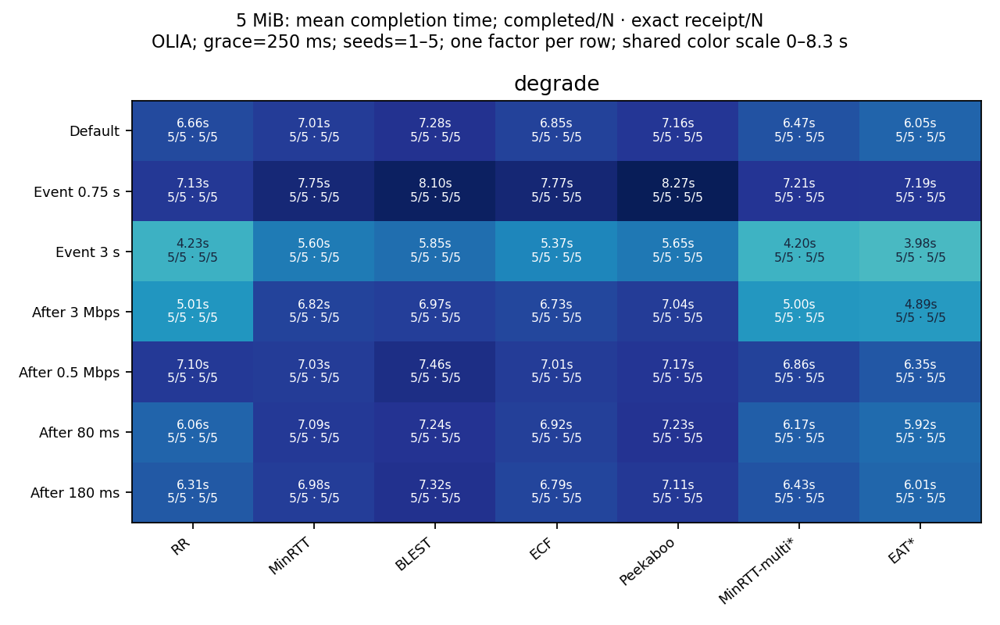
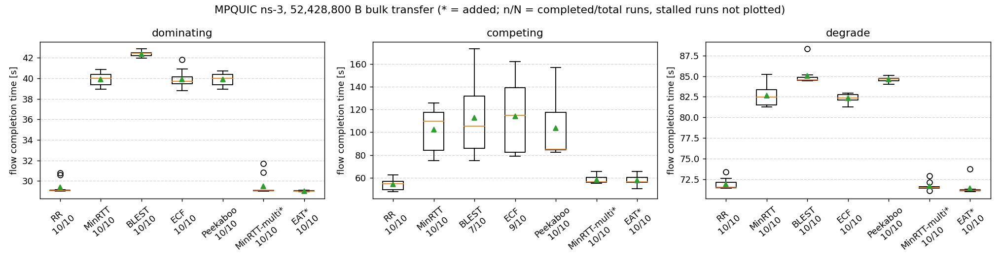
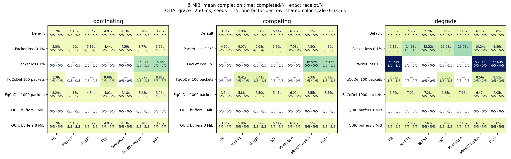

## 1. 4주차 작업 내용

### 1-1. 기존 조건·경로 열화 테스트 (315/315회 완료·전체 수신)

| 테스트 | 측정 범위 | 결과 |
|---|---|---|
| 기존 조건 재현 | 3개 시나리오 × 7개 스케줄러 × seed 1~5 | 105/105회 공식 기준값과 전 측정 항목 일치 |
| 열화 발생 시점 | 전송 시작 후 1.5초 → 0.75초·3초 | 70/70회 완료·전체 수신 |
| 열화 후 속도 | 경로 1의 1Mbps → 0.5Mbps·3Mbps | 70/70회 완료·전체 수신 |
| 열화 후 지연 | 경로 1의 120ms → 80ms·180ms | 70/70회 완료·전체 수신 |

- **수행 방법 (한 번에 한 설정만 변경)**
  - 공통 조건
    - `week4_run.py`로 5MiB(5,242,880B), OLIA 혼잡 제어, 손실률 0, 종료 대기 250ms, 제한 시뮬레이션 시각 60초 적용
    - seed는 반복 실행의 난수 번호. 같은 시나리오·seed에서 스케줄러를 바꾸어 비교
  - **결과**
    - **기존 조건 105회는 2주차 승인 기준과 일치. 새 열화 조건 210회는 제공 기준이 없는 추가 측정으로 보존**

### 1-2. 50MiB 장시간 전송 테스트 (완료 206/210·전체 수신 206/210)

| 스케줄러 | dominating 평균·완료 횟수 | competing 평균·완료 횟수 | degrade 평균·완료 횟수 |
|---|---|---|---|
| RR | 29.3832초 (10/10) | 54.1924초 (10/10) | 71.8608초 (10/10) |
| MinRTT | 39.9149초 (10/10) | 102.3529초 (10/10) | 82.6204초 (10/10) |
| BLEST | 42.3703초 (10/10) | 112.6508초 (7/10) | 85.0136초 (10/10) |
| ECF | 39.9245초 (10/10) | 114.1545초 (9/10) | 82.3179초 (10/10) |
| Peekaboo | 39.9011초 (10/10) | 103.4674초 (10/10) | 84.5942초 (10/10) |
| MinRTT-multi | 29.5030초 (10/10) | 58.3606초 (10/10) | 71.6165초 (10/10) |
| EAT | 29.0294초 (10/10) | 57.8028초 (10/10) | 71.3974초 (10/10) |

- **장시간 기준값 구축 (수십 초 동안 전송되는 50MiB 실험)**
  - 측정 조건
    - 3개 시나리오 × 7개 스케줄러 × seed 1~10 = 210회. QUIC 버퍼 4종 각각 80,000,000B, 제한 시뮬레이션 시각 180초
    - dominating은 경로 1이 빠르고 지연도 짧음. competing은 빠른 경로의 지연이 더 김. degrade는 전송 중 경로 1 열화
  - 집계 방법
    - 전송 완료 시간(FCT)은 전송 시작부터 목표량보다 3,000B 적게 받을 때까지의 시간. 평균·분포는 완료 처리된 실행만 계산하고 완료 횟수 함께 표시
    - 목표 95% 수신 시간(FCT95)은 미완료 실행도 95%에 도달했으면 포함. 전체 수신은 `rx_app==size`로 별도 확인
  - **결과**
    - **완료 206/210, 목표 52,428,800B 전체 수신 206/210. 완료한 실행의 최단 전송 시간 28.9748초**
    - **미완료 조합: competing·BLEST 3회; competing·ECF 1회. 해당 조건에는 제공 기준값 없음**
    - **전체 210행을 `baseline-long.csv`로 별도 동결. 기존 5MiB 기준값 보존**

### 1-3. 손실률·큐·버퍼 변화 테스트 (완료 357/630·전체 수신 357/630)

- 그림의 각 칸은 7개 스케줄러 × 5개 seed. 첫 줄은 완료 횟수, 둘째 줄은 목표 바이트 전체 수신 횟수

- **강건성 확인 (네트워크·메모리 설정 변화에 따른 완료와 전송 시간 비교)**
  - 변경 조건
    - 패킷 손실률 0 → 0.1%·1%, 병목 FqCoDel 큐 상한 10,240 → 100·1,000패킷
    - QUIC 송수신 버퍼 4종 공통 크기 40,000,000B → 1MiB·8MiB. 각각 한 설정 묶음만 변경
  - **결과**
    - **6개 설정 × 3개 시나리오 × 7개 스케줄러 × seed 1~5 = 630회 실행. 완료 357/630, 전체 수신 357/630**
    - **패킷 손실률 0.1%는 98/105회, 1%는 31/105회 완료·전체 수신**
    - **100패킷 큐는 18/105회, 1,000패킷 큐는 105/105회 완료·전체 수신**
    - **1MiB 버퍼는 0/105회, 8MiB 버퍼는 105/105회 완료·전체 수신. 새 조건에는 제공 기준값 없음**
    - **탐색 결과: 7종 전체 쌍의 평균 시간 우열 변화 12개 관찰, 그중 MinRTT-multi 관련 7개. 양 설정에서 두 스케줄러가 모두 완료한 같은 seed끼리 비교**

- 우열 변화에 사용된 공통 완료 seed는 1~5개. 100패킷 큐의 변화 6건은 seed 1개인 경우 5건·2개인 경우 1건으로 탐색적 관찰

### 1-4. 4경로 동작 테스트 (8/8회 완료·전체 수신)

- **경로 수 확장 확인 (기존 두 경로에 8Mbps·20ms 경로 두 개 추가)**
  - 측정 범위
    - ID 0~7 각각 seed 1, 5MiB 전송. 양 끝의 주소·서브플로(경로별 연결) 4개 생성과 경로별 송수신 데이터량 확인
  - **결과**
    - **RR·EAT·MinRTT-multi·ID 7 기본 모드는 경로 0~3에 데이터를 분배**
    - **MinRTT·BLEST·ECF·Peekaboo는 추가 경로에 초기 소량을 보낸 뒤 경로 0·1 위주로 전송**
    - **8/8회 목표 전체 수신. 그림은 재전송을 포함한 누적 송신량이며, 기존 스케줄러의 4경로 사용 범위 확인 결과**

## 2. 특이사항 - 장시간 전송의 버퍼 설정과 미완료 실행

- **장시간 전송 버퍼 조정 (50MiB 실험을 지속할 수 있는 설정 확인)**
  - 최초 문제 상황
    - 버퍼 40,000,000B에서 MinRTT-multi·3개 시나리오 모두 39,795,220B 수신 후 정체
  - 원인 추정
    - 스트림 버퍼에서 소켓 버퍼로 넘기는 중 공간이 부족해지면, 앱 종료 후 남은 데이터를 다시 넘기는 경로에 한계
  - 조치
    - 버퍼 크기만 80,000,000B로 변경 후 같은 seed 재실행. 장시간 기준 실험은 모든 스케줄러에 같은 크기 적용
  - **결과**
    - **예비 3/3회 전체 수신. 전송 시간 29.0925초·56.5048초·71.5711초. 전송·스케줄러 알고리즘 유지**
- **확장 조건의 미완료 기록 (제한 시간 내 완료하지 못한 실행 보존)**
  - 관찰 내용
    - 장시간·작은 큐·버퍼·손실 조건의 미완료는 프로세스 중단과 구분. 구체적인 정체 원인은 미확정
  - **결과**
    - **평균에서 제외된 미완료 수를 완료율·전체 수신율과 함께 제공. 미완료를 포함한 전체 측정값과 원시 로그 보존**

## 3. 재현 패키지·다음 작업

- **게이트 4 (확장 실험과 다음 알고리즘 구현을 위한 재현 자료 준비)**
  - 준비 항목
    - 스케줄러 슬롯·예약 파라미터, 바이트 분배 변환, 도착 시차 로그, 수신 순서 대기량 계측은 3주차 검증 근거 유지
    - 기존 기준값·같은 seed 통계와 별도 장시간 기준값·조건별 한계 자료 준비
  - **결과**
    - **본 측정 1,163회 중 완료 886/1163, 전체 수신 886/1163. 프로세스 오류 0회**
    - **별도 소스 재빌드와 단위 검증 4개 통과. 13회 재실행의 21개 측정 항목 모두 일치**
    - **전체 데이터를 다시 분석한 CSV 9개·그림 6개 일치. 분석 집계 검증 4개 통과**
    - **재현 패키지·중간 보고·준비 6항목의 근거를 정리해 게이트 4 산출물 준비 완료**
- **5주차 계획 (관측한 경로 상태에 따라 비율을 정하는 알고리즘 구현)**
  - 비교 기준
    - MinRTT-multi와 같은 조건·seed로 완료율·전체 수신율·전송 시간을 비교
    - 새 장시간 기준값의 미완료 조합과 4경로 사용 한계를 반영해 구현 범위 확정

## 4. 참고 자료

- **전체 1,163회 시행의 측정값과 조건별 통계**
  - **각 실행의 완료·수신량·전송 시간**
    - https://github.com/JS-KETI/MPQUIC_Scheduler_Lab/blob/lab/week4-validation-20261018/reports/week4/data/results.csv
  - **스케줄러·시나리오·설정별 평균·완료율·전체 수신율**
    - https://github.com/JS-KETI/MPQUIC_Scheduler_Lab/blob/lab/week4-validation-20261018/reports/week4/data/summary.csv
- **이후 비교에 사용할 장시간 전송 기준값**
  - **50MiB 전체 210회 원본**
    - https://github.com/JS-KETI/MPQUIC_Scheduler_Lab/blob/lab/week4-validation-20261018/reports/week4/data/baseline-long.csv
  - **50MiB 스케줄러별 통계**
    - https://github.com/JS-KETI/MPQUIC_Scheduler_Lab/blob/lab/week4-validation-20261018/reports/week4/data/summary-long.csv
  - **같은 seed의 시간차·신뢰구간·승패 비교**
    - https://github.com/JS-KETI/MPQUIC_Scheduler_Lab/blob/lab/week4-validation-20261018/reports/week4/data/paired_comparisons.csv
- **시각화·재현 자료**
  - **장시간 전송 완료와 전체 수신 비율**
    - https://github.com/JS-KETI/MPQUIC_Scheduler_Lab/blob/lab/week4-validation-20261018/reports/week4/figures/long_completion.png
  - **장시간 전송의 경로 1 수신 IP 바이트 비중**
    - https://github.com/JS-KETI/MPQUIC_Scheduler_Lab/blob/lab/week4-validation-20261018/reports/week4/figures/long_path_share.png
  - **스케줄러별 손실률·큐·버퍼 비교 그림**
    - https://github.com/JS-KETI/MPQUIC_Scheduler_Lab/blob/lab/week4-validation-20261018/reports/week4/figures/robustness.png
  - **소스·설치·명령·데이터·그림 재현 패키지**
    - https://github.com/JS-KETI/MPQUIC_Scheduler_Lab/blob/lab/week4-validation-20261018/artifacts/week4/package/2026-10-18/README.md
  - **예비 시도·전체 미완료 조합·재현 검증 상세 기록**
    - https://github.com/JS-KETI/MPQUIC_Scheduler_Lab/blob/lab/week4-validation-20261018/reports/week4/records/4%EC%A3%BC%EC%B0%A8%20%EC%83%81%EC%84%B8%20%EC%8B%A4%ED%97%98%20%EA%B8%B0%EB%A1%9D.md
